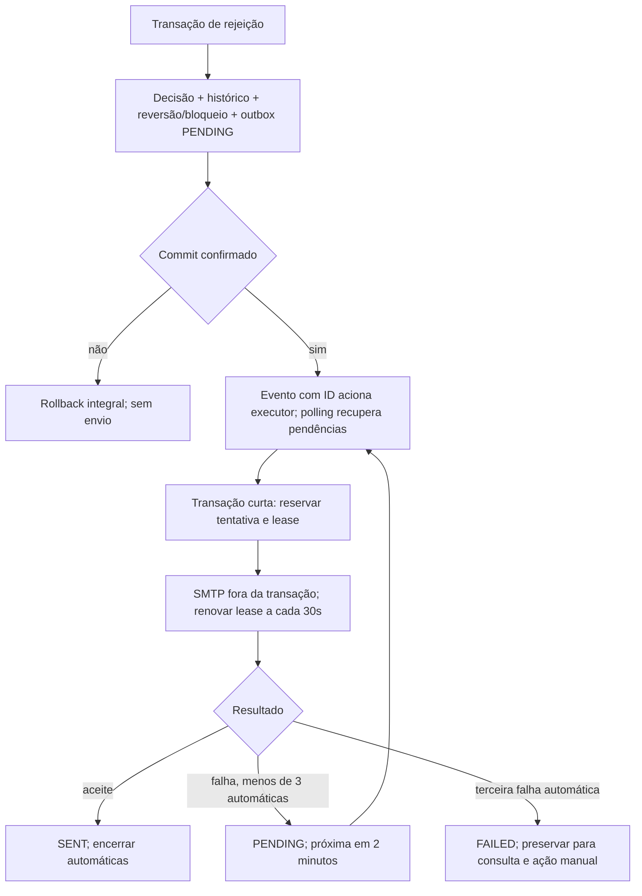

# Confiabilidade das notificações — BACK-542 / BACK-543

## Decisões aprovadas D01–D05

D01/D02: aprovação, provisionamento e hash do token são confirmados antes de enviar
convite. Falha SMTP posterior não desfaz aprovação e não muda o sucesso HTTP da
decisão; o link continua na resposta administrativa com `Cache-Control: no-store`.
Esse sucesso não confirma envio. Reenvio manual mantém o User e a matrícula,
invalida os tokens anteriores e confirma o novo hash antes de enviar. Apenas o
bearer em memória atravessa a fronteira de commit; não existe outbox de convites,
retry automático, token bruto, URL bearer ou corpo de convite persistidos.

```mermaid
sequenceDiagram
    participant Admin
    participant Membership
    participant DB
    participant SMTP
    Admin->>Membership: Aprovar / reenviar convite
    Membership->>DB: Provisionar se aprovação; invalidar tokens; salvar hash
    DB-->>Membership: Commit da transação externa
    Membership->>DB: Revalidar aplicação/token em transação nova
    Membership->>SMTP: Convite com bearer apenas em memória
    SMTP-->>Membership: Aceite ou falha sanitizada
    Membership-->>Admin: Contrato atual; aprovação inclui link; no-store
```

O callback só executa depois do commit efetivo; rollback e falha de commit não
invocam SMTP. Falha operacional é registrada sem exceção do provedor, dados
pessoais ou bearer. Crash entre commit e callback pode perder o convite. O admin
recupera pelo reenvio manual; ele pode gerar um link mais novo enquanto um envio
anterior já começou. Não há promessa de entrega única ou de entrega de convite.

D03: toda rejeição com e-mail gera outbox na mesma transação da decisão,
histórico, reversão segura de Identity e bloqueio de CPF, quando aplicáveis.
Motivo ausente também gera comunicação. Solicitação sem e-mail não gera fila.
Rollback elimina todos os efeitos, inclusive a outbox. A migration V11 cria
somente estrutura; não altera decisões existentes nem gera backfill.



A política é **três tentativas automáticas totais**, incluindo a primeira,
despachada após commit. Segunda e terceira ficam elegíveis exatamente dois
minutos depois da falha anterior; a execução pode ocorrer depois sob carga.
Todos os instantes usam `Clock` UTC. O polling padrão de um segundo consulta até
50 IDs, em executor limitado, sem bloquear o scheduler global. Evento é apenas
um acelerador; os registros do banco são a fonte de recuperação após reinício.

D04: reenvio usa a permissão existente de rejeição administrativa. Faz uma
nova tentativa `MANUAL` imediata, com ator e resultado no histórico, sem
reiniciar ou incrementar o contador automático. Funciona antes ou depois de
esgotar o ciclo e depois de aceite prévio. Sucesso cancela pendências automáticas;
falha preserva o horário automático anterior, quando existente. Não modifica
a decisão, motivo, Identity, bloqueio ou matrícula. Rejeições históricas sem fila
podem receber uma fila somente por solicitação manual explícita; isso não inicia
um ciclo automático retroativo.

A API administrativa expõe estado, contador, horários e histórico por solicitação
com permissão de leitura, sem nome/e-mail/motivo. Reenvio retorna `SMTP_ACCEPTED`
somente quando o sender SMTP retorna normalmente. Isso significa aceite pelo
provedor, não entrega à caixa postal ou leitura. Nos perfis `dev`/`test`, o dummy
retorna `SIMULATED`, sem preencher `smtpAcceptedAt`. Falha SMTP retorna 502;
resultado não confirmado no banco retorna 503 e exige consulta antes de repetir.
404 indica recurso ausente e 409 indica estado incompatível, falta de destinatário
ou tentativa em processamento. Autenticação e permissão usam 401/403 RFC 9457.
O contrato detalhado está no OpenAPI dos controllers.

D05: texto genérico aprovado é sempre incluído; motivo opcional acrescenta somente
o texto persistido na decisão. `null`, vazio e espaços resultam na mensagem genérica.
O motivo tem limite de 2000 caracteres, controles removidos e bordas aparadas antes
da persistência. Retry não altera esse conteúdo. A outbox não copia dados pessoais
nem inclui autenticação; referencia applicationId e versão imutável da decisão.

## Concorrência e ambiguidade

Claims manuais e automáticos bloqueiam a mesma linha em transações curtas. A
reserva é confirmada antes do SMTP, sem manter lock durante I/O. Unicidade por
applicationId/tipo deduplica a decisão; numeração automática 1–3 é única por
notificação. Reenvio histórico serializa a criação pelo lock da solicitação.

Cada tentativa tem ID próprio, prazo de cinco minutos e renovação a cada 30
segundos enquanto o sender está ativo. Um resultado antigo não pode sobrescrever
uma reserva nova. Lease abandonada registra `UNKNOWN` no histórico; tentativas
automáticas abandonadas contam para o limite original e aguardam dois minutos
após a detecção. O terceiro abandono termina em FAILED. Operação manual abandonada
não reinicia o ciclo. Jobs e renovações registram apenas IDs técnicos e códigos
fixos; exceções SMTP nunca chegam ao logger ou ao handler HTTP.

**Não existe exactly-once.** Se o SMTP aceitar e o registro final falhar, ou uma
JVM inteira pausar/perder acesso ao banco por mais que a lease e retomar depois de
outro worker assumir, pode haver duplicação. Renovação e fencing do resultado
minimizam a janela, mas não tornam o SMTP transacional. `UNKNOWN` identifica essa
ambiguidade. Convites também podem se perder após commit, com recuperação manual.

## Retenção e operação

Política desta entrega: preservar pendências e registros PROCESSING sem expurgo.
Histórico e metadados de notificações terminais são elegíveis para revisão de
retenção após **90 dias da última tentativa terminal**, em conjunto com a política
de retenção da solicitação e obrigações de auditoria. Qualquer limpeza exige
procedimento administrativo revisado, preservando pendências e consistência das
referências. Não há job destrutivo de limpeza nesta entrega nem novo acesso
público à fila. Backups e permissões seguem os controles do banco existente.

Monitorar warnings sanitizados e consultar falhas finais pelo recurso administrativo.
Falhas de polling/dispatch não removem pendências; próximo polling tenta novamente.
Desativar `memberships.notifications.worker.enabled` pausa execução automática sem
apagar a fila. `memberships.notifications.poll-delay-ms` ajusta a frequência;
o limite de tentativas e os dois minutos não são configuráveis neste escopo.
